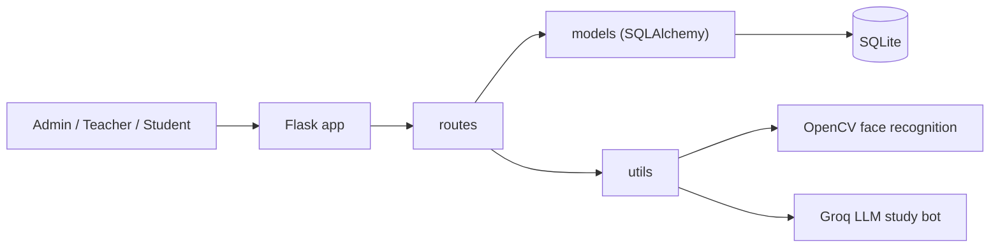

<!-- Profile README for github.com/mishrapranshu9161/mishrapranshu9161
     Anything inside <!-- ... --> comments is hidden on GitHub. Uncomment lines marked TODO once you have the link. -->

<div align="center">


<a href="https://github.com/mishrapranshu9161">
  
</a>

<br/>

[](https://www.linkedin.com/in/pranshu-mishra-386873322)
[](mailto:mishrapranshu9161@gmail.com)
<!-- TODO: uncomment after you add your live portfolio link
[](https://YOUR-PORTFOLIO-URL)
-->


**[Projects](#-featured-projects) · [Tech Stack](#-tech-stack) · [Experience](#-experience) · [GitHub Activity](#-github-activity) · [Contact](#-lets-connect)**

</div>

---

## 👋 About Me

```python
class PranshuMishra:
    role      = "AI-integrated Full-Stack Developer"
    education = "B.Tech CSE · SRMU Lucknow · Class of 2027"
    location  = "Lucknow, India"
    focus     = ["LLM apps", "Flask / REST APIs", "MERN stack", "Computer Vision"]
    building  = "UniversityNova — AI-powered University ERP"
    learning  = ["Deep Learning", "NLP", "Computer Networks"]
    status    = "Open to internships & entry-level roles"
```

---

## 🚀 Featured Projects

| Project | What it does | Stack | Links |
|---|---|---|---|
| 🎓 **UniversityNova** | AI-powered University ERP with face-recognition attendance, a syllabus-aware study bot and fee management | Flask · SQLite · OpenCV · Groq LLM | [Repo](https://github.com/mishrapranshu9161/UniversityNOVAA) <!-- TODO: add · [Live Demo](URL) --> |
| 🛡️ **FakeShield** | Misinformation detector: credibility score, editorial bias detection, fact-check lookup | Python · Groq LLM · Google Fact Check API · Vite | [Live Demo](https://fakeshield-nine.vercel.app) · [Repo](https://github.com/mishrapranshu9161/fakeshield) |
| 🏥 **MediPredict** | Hospital management system with role-based portals, appointments, prescriptions and symptom risk assessment | MongoDB · Express · React · Node.js | [Repo](https://github.com/mishrapranshu9161/Medipredict) |

<details>
<summary><b>🎓 UniversityNova — click for details</b></summary>

<br/>

**Problem:** colleges juggle attendance sheets, fee counters and scattered study material across different tools.
**Solution:** one Flask-based platform with separate Admin, Teacher and Student roles.

- 📍 **Smart Attendance** — GPS + face recognition
- 🤖 **AI Study Bot** — syllabus-aware answers via Groq LLM
- 💳 **Fee Management** — PDF + UPI + NetBanking
- 📊 **Analytics** — Chart.js dashboard
- 🔐 **Role system** — Admin · Teacher · Student



[📂 View repository](https://github.com/mishrapranshu9161/UniversityNOVAA)

</details>

<details>
<summary><b>🛡️ FakeShield — click for details</b></summary>

<br/>

**Key insight:** a news article can be *real but biased*. FakeShield scores credibility **and** labels editorial slant.

- 🧠 **Bias detection** — Neutral · Left-Leaning · Right-Leaning · Sensationalist · Pro-Government · Anti-Government
- ✅ **AI credibility score** with suspicious-keyword highlights
- 🔎 **Google Fact Check API** results alongside the AI verdict
- 📸 **Share as image** and ⬇️ **Export history as CSV**

[🚀 Try it live](https://fakeshield-nine.vercel.app) · [📂 View repository](https://github.com/mishrapranshu9161/fakeshield)

</details>

<details>
<summary><b>🏥 MediPredict — click for details</b></summary>

<br/>

- 👥 **3 role-based portals** — Patient, Doctor, Admin (JWT + bcrypt, Helmet, rate limiting)
- 🗓️ **Double-booking prevention** — server-side validation + compound index on doctor/date/slot
- 🖨️ **Printable digital prescriptions** and lab report tracking
- 📈 **Admin analytics** with Recharts
- 🧠 **Symptom risk engine** — rule-based weighted scoring, built as a swappable service so a Python ML model can replace it later

[📂 View repository](https://github.com/mishrapranshu9161/Medipredict)

</details>

---

## 🛠️ Tech Stack

**Languages**


**Backend & Databases**


**Frontend**


**AI / ML**


**Tools**


---

## 💼 Experience

- **Intern — Netcamp.in**
  <!-- TODO: add role, duration and 2 bullets: what you built + a measurable result (e.g. "Built X using Y, reduced Z by N%") -->

---

## 📈 GitHub Activity

<div align="center">

<picture>
  <source media="(prefers-color-scheme: dark)" srcset="https://raw.githubusercontent.com/mishrapranshu9161/mishrapranshu9161/output/github-contribution-grid-snake-dark.svg">
  <source media="(prefers-color-scheme: light)" srcset="https://raw.githubusercontent.com/mishrapranshu9161/mishrapranshu9161/output/github-contribution-grid-snake.svg">
  
</picture>


</div>

---

## 🎯 Let's Connect

I'm looking for **internships and entry-level roles** in AI / full-stack development. If you're hiring or want to collaborate, reach out:

[](https://www.linkedin.com/in/pranshu-mishra-386873322)
[](mailto:mishrapranshu9161@gmail.com)

<div align="center">

*"Building systems that think."*


</div>
